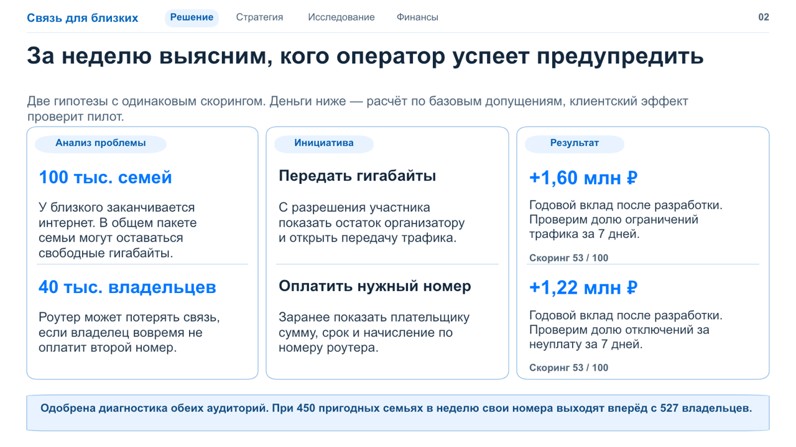
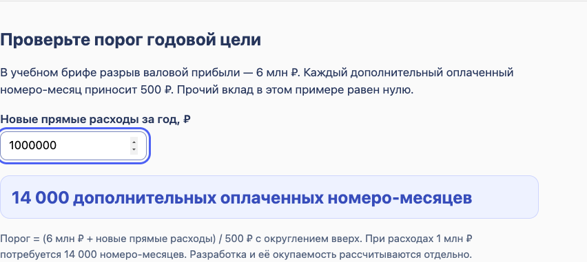
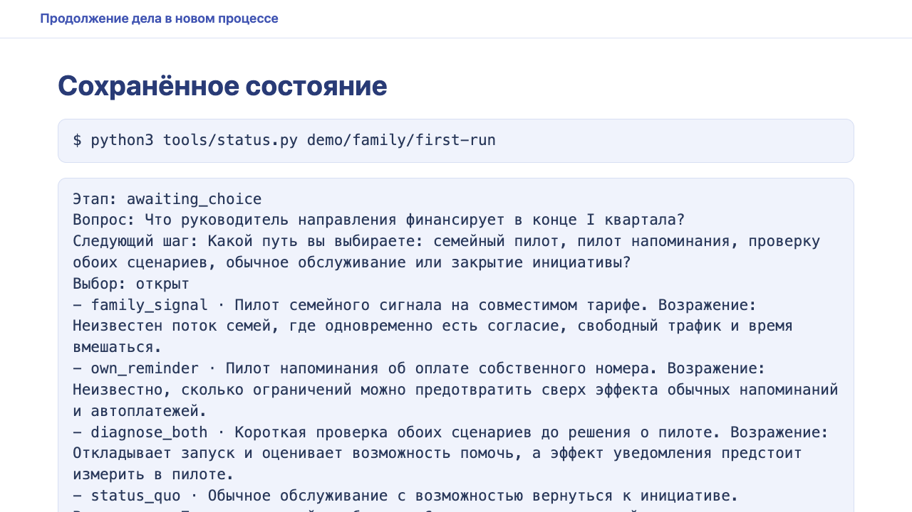

# Как работает «Стратег Фабрики продуктов»

## Что получает руководитель

Руководитель учебного оператора решает, куда направить ограниченное время команды. Агент показывает два момента, когда оператор может успеть помочь клиенту, сравнивает их с обычным обслуживанием и называет данные, от которых зависит выбор.

**Что смотреть в демо.** Из файла `Старт.html` откройте инвестиционную защиту. Слайд 2 сравнивает две инициативы. Слайд 8 показывает поручение руководителя и результаты по дням одобренной недели. Слайд 10 объясняет, в каких случаях действующий сервис решает задачу сам. На слайдах 14 и 16 можно проверить, какой поток нужен для набора выборки и при каком потоке меняется экономический выбор.

**Что сохранено.** Восемь основных слайдов и двенадцать приложений собраны в одной презентации. К ней приложена книга Excel с предпосылками и квартальными когортами. Если ожидаемый эффект для владельцев своих номеров снижается на 10%, порог смены выбора растёт с 527 до 586 пригодных владельцев в неделю. В первой версии дела сохранено сравнение до выбора, во второй — дословный ответ руководителя и три поручения. Бюджет пилота будет рассмотрен после среза.

<!-- page -->

## От запроса до двух согласованных стратегий

| Шаг | Работа агента | Что можно проверить |
| --- | --- | --- |
| Уточнить | Определяет, кто выбирает, к какому сроку и какой результат изменит решение | Вопрос и критерий результата |
| Найти основания | Извлекает фрагменты документов и таблиц, записывает URL и место на странице, выносит пробелы в отдельный список | Переход от утверждения к источнику, странице или ячейке |
| Сравнить | Включает текущий порядок, проверяет сильное возражение для каждого варианта. Четыре критерия оцениваются по шкале 0–4 | Веса, обоснования и чувствительность результата к изменению весов |
| Спросить | Показывает записку, карту и презентацию. При равенстве указывает, какие наблюдения помогут выбрать | Сохранённое состояние ожидания и ответ руководителя, когда он поступит |
| Продолжить | Связывает продуктовую операцию с сообщением, обещанием, каналом и подтверждением. Назначает проверку и дату пересмотра | Две стратегии, план, условия остановки и журнал изменения решения |

**Кто делает работу.** Клиент Codex или Claude читает навык из папки. Доступной экономной модели можно поручить поиск. Синтез с противоречивыми источниками оправдывает обращение к более сильной модели. Оценки, обязательные файлы и сборку PPTX проверяет Python. Если клиент предоставляет только одну модель, шаги на ней сохраняются.

**Как продолжить с другого компьютера.** Передайте папку дела целиком вместе с проектом. Запустите из корня проекта `python3 tools/status.py demo/family/first-run`. Новый сеанс получает вопрос, стадию и следующий шаг. Первичные данные остаются прослеживаемыми в реестре. Если карта пропущена, команда `handoff.py repair` может восстановить её из заполненных входов с сохранением существующей презентации.

<!-- page -->

## Экономика решения и стоимость работы агента

**Экономика оператора.** Разрыв между минимальной годовой целью и прогнозом обычного обслуживания составляет 6 млн ₽. При вкладе 500 ₽ за дополнительный оплаченный номеро-месяц нужны 12 000 таких месяцев в плановом году. Новый прямой расход в 1 млн ₽ поднимает порог до 14 000 при прежних условиях. В брифе отсутствует частота пригодных эпизодов для обоих пилотов.

**Экономика агента.** В отдельном испытании на задаче библиотеки обычный Codex за 62 секунды подготовил записку и использовал 104 903 токена. С навыком за 138 секунд получены также источники, состояние и презентация при 391 353 токенах. Первая выдача пропустила программный скоринг. Восстановление новой модельной сессией заняло 275 секунд и 1 337 035 токенов. Построенная после этого локальная команда восстановила карту за 0,14 секунды на уже заполненных входах. Экономия полного повторного запуска ещё требует измерения. Фактическое списание по подписке неизвестно.

**Варианты запуска.** Для просмотра примера и пересчёта экономики достаточно локального HTML. В демонстрации использован Codex по подписке. Отдельная команда Python работает с ключом OpenAI через Responses API. Обычный путь требует двух запросов и создаёт сравнение, стратегии и редактируемый PowerPoint. Протокол, ошибки и восстановление проверены локальным HTTP-сервером; платный запрос с настоящим ключом в приёмку не входил.

Подробные исходные данные и результаты находятся в `demo/family/`, а методика измерения запуска — в `methods/benchmark.md`.

<!-- page -->

## Инструменты, инструкции и участие человека

**Демонстрационный проект.** Первый исследовательский сеанс в Codex CLI по подписке занял около 83 секунд. В сводке клиента указаны gpt-6.2-sol, низкий уровень рассуждений и 45 795 токенов без разбивки. Измерен период от открытия журнала до итогового вопроса руководителю. Траты на подписку и время ручной доработки презентации отдельно не измерены. На втором компьютере Егор успешно открыл сохранённое дело и проверил, какие оценки связаны с финансовым основанием E6.

**Инструменты проекта.** Codex или Claude Code ведёт диалог и управляет файлами. Поисковый инструмент клиента читает разрешённые веб-страницы. Python читает таблицы и документы, рассчитывает баллы, финансовую модель и интервалы исходов, собирает PowerPoint и проверяет состояние. Для текстовых PDF используется Poppler. Локальная страница HTML показывает пример и пересчитывает финансовый порог. GitHub хранит версии и результаты командной проверки.

**Инструменты разработки.** Шаблон использует компоненты собственных кейсов VK и Nanimai. Работоспособность локального интерфейса и снимки проверяли в Chrome через Playwright. Пакет PPTX хранит текст и заметки докладчика в редактируемом виде. Для повторной сборки из включённого шаблона достаточно Python.

| Момент | Рабочая формулировка промпта |
| --- | --- |
| Старт руководителя | «Рассмотри оба предупреждения на равных. Сравни с обычным обслуживанием и закрытием инициативы. Покажи, что изменит выбор». |
| Работа исследователя | «Определи неизвестное, которое может изменить приоритет. Найди первичный источник, проверь период, единицу, знаменатель и сильную альтернативу». |
| Перерыв | «Продолжи сохранённое дело. Покажи открытые варианты, на какие оценки влияет новый факт и какой шаг требуется от меня». |

Григорий задал равный приоритет пилотов и исправил требования к презентации. Эти указания определили сравнение и оформление. Финансирование остаётся отдельным решением. В автономном режиме по умолчанию выбрана gpt-4.1-mini, имя доступной модели можно задать флагом `--model`. Точный текст навыка лежит в `.agents/skills/product-strategist/SKILL.md`, расчёты и журнал сеанса — в `demo/family/first-run/`.

<!-- page -->

## Дополнительный уровень после решения

**Продолжение после перерыва.** На снимке новый процесс открыл первую версию дела, когда выбор ещё был открыт. Во второй версии сохранена точная формулировка руководителя и три обязательства. Аналитик получает сравнимый поток, специалист по биллингу сверяет причины и статусы, руководитель на пятый день возвращается к бюджету. Сроки записаны относительно начала диагностической недели.

**Как агент пересматривает вывод.** Если обычный сервис уже решает 42 из 450 пригодных семейных случаев в неделю, для нового сигнала остаётся 408. При тех же остальных допущениях и 468 владельцах меняется экономический лидер. В задаче это расчёт чувствительности. Команда проверяет его на фактическом потоке; выбор по-прежнему делает руководитель.

**Что реализовано и проверено.** Продуктовые пути связаны с правами, подтверждением операции и исходом за семь дней. Финансовая модель пересчитывает кварталы, границы и стресс-сценарии. Новый факт можно проследить от идентификатора источника до расчёта и поручения. Команда `follow_up.py demo/family/decision --evidence E6` показывает затронутые обязательства.

**Границы доказательств.** Реестр содержит учебный бриф и открытые страницы действующих сервисов. Реальных клиентских интервью и фактического эффекта пилота в деле нет. Указаны критерии для проверки на данных оператора. Экономика агента и экономика оператора считаются раздельно.
